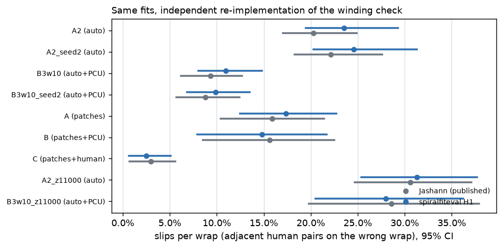

# spiralfiteval

Score a spiral fit of a Herculaneum scroll from its output meshes alone: how often it puts the
sheet on the wrong wrap, whether it stacks two windings on one sheet, and how close it stays to
the organisers' eval fibers. CPU only, no GPU, works on fits from any fitter (villa
`fit_spiral.py` tifxyz folders or `.npz` grids).

**Start here: [`tools/spiralfiteval/README.md`](tools/spiralfiteval/README.md)** (quickstart, what
it measures, prior work). Scores of every published fit I could download, and one command to add
your own: [`tools/spiralfiteval/leaderboard/`](tools/spiralfiteval/leaderboard/README.md).

## What came out

- The winding check (Jashann's "slips per wrap") reproduces his published numbers: inside his
  95 % CI on all 9 runs he reports, and within 1.5 points on all 13 Paris 4 runs on his own
  held-out ladders.
- Every published fit on PHerc. 0826 and 0211 has 6.5–8.6 % of its surface on a duplicated
  winding, 2–8× the Paris 4 fits. On Paris 4 almost all duplicates sit in the surplus outer
  windings.
- With patch inputs, turning on `fit_spiral.py`'s dense-spacing loss cut slips per wrap from
  20.6 % to 7.7 % on held-out human chains. With track inputs the same change showed no effect.

## What does not work yet

- Only Paris 4 has public human winding chains, so the winding check runs on one scroll. The
  duplicate check runs on any scroll.
- The eval-fiber metrics do not beat their floor on most unrefined fits, so they cannot rank them.

## Layout

| Path | Content |
|---|---|
| `tools/spiralfiteval/` | the tool: code, tests, quickstart, leaderboard |
| `tools/windingcheck/`, `tools/windbench/` | two small packages spiralfiteval uses (human chain reader, trace metrics) |
| `experiments/2026-10-13-spiralfit-eval/` | the scores of 20 published fits: README, scripts, `results.json`, figures |

## Licence and data

Code: MIT, see `LICENSE`.

The scan data and annotations this code reads are published by the Vesuvius Challenge and
EduceLab under CC BY-NC 4.0 and are not redistributed here. Cite the scans as:

> S. Parsons, C. S. Parker, C. Chapman, M. Hayashida, W. B. Seales,
> *EduceLab-Scrolls: Verifiable Recovery of Text from Herculaneum Papyri using
> X-ray CT*, arXiv:2304.02084, 2023.

See <https://scrollprize.org/data> for the data agreement and `tools/spiralfiteval/DATA_NOTICE.md`
for the full citations. PHerc. Paris 4 material is under a publication reservation and no CT or
image of it is included; the outputs are coordinates and scores only.

Johannes Pfeffer (`jo-tud`)
